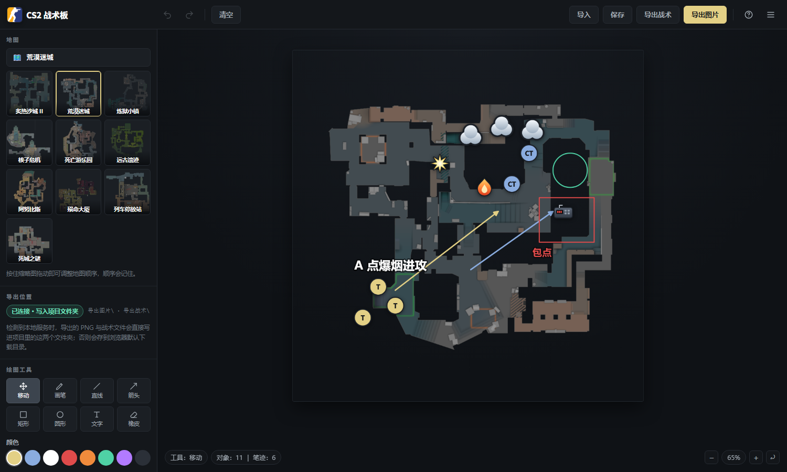

# CS2 战术板

一个仿 [scope.gg 战术板](https://app.scope.gg/strategy) 的**纯本地、全中文** CS2 战术演示工具。
打开网页就能在雷达图上画进攻路线、摆队员站位、标投掷物落点，然后把战术图导出成 PNG 发给队友。

- **零依赖**：不需要构建、不需要安装任何 npm 包，双击就能用。
- **零联网**：所有地图、图标、代码都在本地，数据只存在你自己的浏览器里，不上传任何服务器。
- **全中文界面**：地图名、工具、菜单、提示全部汉化。



---

## 目录

- [功能总览](#功能总览)
- [快速开始](#快速开始)
- [界面说明](#界面说明)
- [操作手册](#操作手册)
- [导出与存档](#导出与存档)
- [目录结构](#目录结构)
- [自测](#自测)
- [技术实现](#技术实现)
- [常见问题](#常见问题)
- [已知限制](#已知限制)
- [更新记录](#更新记录)
- [数据来源与声明](#数据来源与声明)

---

## 功能总览

| 模块 | 说明 |
| --- | --- |
| **地图** | 10 张 CS2 雷达图，缩略图可拖动排序，顺序自动记住 |
| **绘图** | 画笔、直线、箭头、矩形、圆形、文字、橡皮，共 7 种笔 + 移动工具；8 种颜色、2–24px 粗细 |
| **队员** | CT 与 T 各 5 个：蓝色实心圆标 `CT`、黄色实心圆标 `T` |
| **道具** | 烟雾弹、闪光弹、手雷、燃烧弹、C4 炸弹，共 5 种，大小可自由缩放 |
| **编辑** | 拖动移动、右键菜单（旋转 / 复制 / 置顶 / 删除）、撤销重做、橡皮擦 |
| **视图** | 滚轮缩放、中键或移动工具平移、一键重置视图、收起侧栏 |
| **存档** | 自动保存到浏览器、导出战术 `.json`、导入战术文件、导出 PNG 图片 |
| **导出落盘** | 启动本地服务时，导出直接写进项目内的 `导出图片\` 与 `导出战术\` 文件夹 |

### 地图列表

| 中文名 | 英文名 | 地图 ID |
| --- | --- | --- |
| 炙热沙城 II | Dust II | `de_dust2` |
| 荒漠迷城 | Mirage | `de_mirage` |
| 炼狱小镇 | Inferno | `de_inferno` |
| 核子危机 | Nuke | `de_nuke` |
| 死亡游乐园 | Overpass | `de_overpass` |
| 远古遗迹 | Ancient | `de_ancient` |
| 阿努比斯 | Anubis | `de_anubis` |
| 殒命大厦 | Vertigo | `de_vertigo` |
| 列车停放站 | Train | `de_train` |
| 死城之谜 | Cache | `de_cache` |

### 绘图颜色

默认黄 `#E3D085`、队友蓝 `#8AACDF`、白色 `#FFFFFF`、危险红 `#E04B4B`、
燃烧橙 `#F08B3C`、薄荷绿 `#4FD1A5`、紫色 `#B27BFF`、深灰 `#2B3038`。

---

## 快速开始

### 环境要求

- 一个现代浏览器（推荐 **Chrome / Edge** 最新版，Firefox、Safari 亦可）。
- **方式二需要 [Node.js](https://nodejs.org)（建议 18 以上）**；方式一不需要任何环境。

### 方式一：启动本地服务（推荐，功能完整）

双击 **`serve.cmd`**，或在项目目录下执行：

```bat
node serve.js
```

终端会打印地址，浏览器打开它：

```
http://127.0.0.1:8123/index.html
```

命令行参数：

- 端口默认 `8123`，被占用时自动往后试到 `8132`；也可用环境变量指定起始端口：`set PORT=9000 && node serve.js`。
- 页面自己也会探测 `8123–8132`，所以换端口后仍然能自动找到服务。

### 方式二：直接打开（不需要任何环境）

双击 **`index.html`** 即可使用。选地图、画图、摆位、自动保存、导入战术文件都正常。

差别只在导出：

| 场景 | 方式一（本地服务）| 方式二（直接打开）|
| --- | --- | --- |
| 导出图片 PNG | 写进项目 `导出图片\` | 被浏览器拦截并提示改用 `serve.cmd` |
| 导出战术 JSON | 写进项目 `导出战术\` | 下载到浏览器默认下载目录 |

**为什么方式二导不出 PNG？** 直接打开时页面地址是 `file://`，浏览器把 `file://` 加载的图片
视为「跨源资源」，画到 canvas 后就不允许再导出（`Tainted canvases may not be exported`）。
方式一下图片走 `http://127.0.0.1`，没有这个问题。

---

## 界面说明

```
┌──────────────────────────────────────────────────────────────────────┐
│ 顶栏  官方 CS2 图标 · CS2 战术板 │ 撤销 重做 清空 │ 导入 保存 导出战术 导出图片 帮助 收起侧栏 │
├───────────────┬──────────────────────────────────────────────────────┤
│ 侧栏           │ 画布                                                  │
│  地图          │   ┌────────────────────────────┐                      │
│  导出位置      │   │  雷达图 + 笔迹层 + 对象层   │                      │
│  绘图工具      │   └────────────────────────────┘                      │
│  颜色 / 粗细   │                                                       │
│  战术对象      │   工具：移动   对象：0｜笔迹：0          − 100% + ⟲   │
└───────────────┴──────────────────────────────────────────────────────┘
```

**顶栏**

- `撤销` / `重做`：按操作步回退或前进，最多 80 步。
- `清空`：清掉当前地图上的全部笔迹与对象（会二次确认）。
- `导入`：读取之前导出的 `.json` 战术文件。
- `保存`：把当前战术以自定义名称存到浏览器本地（见[已知限制](#已知限制)）。
- `导出战术` / `导出图片`：导出 `.json` / `.png`。
- `帮助`：弹出操作说明；`收起侧栏`：让画布占满窗口，再点一次还原。

**侧栏**

- **地图**：当前地图名 + 10 张缩略图。当前地图高亮，按住缩略图拖动可调整顺序。
- **导出位置**：显示当前是否连上本地服务（`已连接 · 写入项目文件夹` / `未连接 · 存到下载目录`）。
- **绘图工具**：8 个工具按钮，选中项高亮。
- **颜色 / 粗细**：8 个色块 + 2–24px 滑杆，实时显示当前线宽。
- **战术对象**：`队员` 10 个（5 蓝 CT、5 黄 T）、`道具与炸弹` 5 个。

**画布**

- 左下角显示当前工具与对象/笔迹数量；右下角是缩小、缩放比例、放大、重置视图。
- 首次载入地图时中央有加载转圈；雷达图加载失败会提示并显示条纹占位底。

**右键菜单**

在对象上点右键弹出：

| 菜单项 | 队员 | 道具/炸弹 |
| --- | :---: | :---: |
| 顺时针 / 逆时针旋转 15° | — | ✅ |
| 放大图标 / 缩小图标 | — | ✅ |
| 复制对象 | ✅ | ✅ |
| 置于最前 | ✅ | ✅ |
| 删除对象 | ✅ | ✅ |

队员是没有方向的圆标，所以旋转与缩放对它没有意义，菜单里会自动隐藏。

---

## 操作手册

本项目**不提供键盘快捷键**，所有操作都由鼠标点击、拖动和右键菜单完成。

### 1. 选择地图

在左侧「地图」里点一张缩略图即可切换。切换后画布自动适配窗口大小，当前地图名显示在侧栏顶部。

### 2. 调整地图顺序

按住某张缩略图**拖动**到目标位置：拖到目标缩略图左半边会插到它前面，右半边插到它后面，
插入位置会显示一条金色竖条。松手即保存，底部提示「地图顺序已保存」。
顺序存在浏览器本地，下次打开仍然是你排好的顺序。

### 3. 画图

1. 在「绘图工具」里选一个工具（画笔 / 直线 / 箭头 / 矩形 / 圆形 / 文字）。
2. 选颜色、拖滑杆调粗细。
3. 在地图上按住并拖动即可画出；文字工具会弹输入框，回车确认。

- **画笔**：自由曲线，适合画走位路线。
- **直线 / 箭头**：适合画进攻方向，箭头自动带箭头头部，大小随线宽变化。
- **矩形 / 圆形**：适合框出包点、卡点范围。
- **文字**：在落点处写标注，颜色与粗细沿用当前设置。
- **橡皮**：在笔迹上单击即可删掉那一笔（命中范围做了放大，细小笔迹也好点中）。

### 4. 放置队员与道具

- 方式 A：点一下左侧图标（高亮表示已选中），再点地图上的落点。**再点一次该图标可取消放置**。
- 方式 B：直接把图标从侧栏**拖到**地图上松手。

放好后会自动选中新对象。

### 5. 移动、缩放、旋转对象

- **移动**：切到「移动」工具，按住对象拖动。在空白处轻点可以取消选中。
- **缩放道具/炸弹**：选中后右下角出现一个金色方块把手，拖动它即可自由放大缩小；
  也可以用右键菜单的「放大图标 / 缩小图标」按 15% 步进微调。缩小时会弹出提示告诉你当前尺寸。
- **旋转道具/炸弹**：右键菜单每次转 15°。
- **复制 / 删除 / 置顶**：都用右键菜单。

### 6. 撤销与重做

顶栏的 `撤销` / `重做` 按钮。每一步画图、放置、移动、缩放、删除、切换地图都会记入历史（最多 80 步）。

### 7. 平移与缩放视图

- **平移**：按住鼠标**中键**拖动；或者用「移动」工具在空白处按住拖动。
- **缩放**：鼠标滚轮，以光标位置为中心缩放。
- **重置**：右下角 `⟲` 按钮回到「整张地图刚好铺满窗口」的初始视图。

---

## 导出与存档

### 导出图片（PNG）

点顶栏 `导出图片`。会把当前战术板重绘到一张 1600×1600 的 canvas 上再导出：

- 包含：雷达图 + 全部笔迹 + 全部对象 + 右下角水印「<地图名> · CS2 战术板」。
- 不包含：侧栏、顶栏等界面元素。
- 文件名：`cs2-tactics-<地图ID>-<年月日-时分秒>.png`，例如 `cs2-tactics-de_mirage-20261005-183213.png`。
- 有本地服务时写进 `导出图片\`，并提示「图片已保存到 导出图片/xxx.png」。

### 导出战术（JSON）

点顶栏 `导出战术`，得到 `cs2-tactics-<地图ID>-<时间戳>.json`，有服务时写进 `导出战术\`。

文件结构：

```json
{
  "app": "cs2-tactics-board",
  "name": "战术 1",
  "exportedAt": "2026-10-05T18:32:13.000Z",
  "mapId": "de_mirage",
  "selectedId": null,
  "entities": [
    {
      "id": "p-3-k2x9a",
      "kind": "player",
      "team": "ct",
      "color": "#8AACDF",
      "index": 1,
      "x": 512.5,
      "y": 300.25,
      "size": 46,
      "rot": 0
    },
    {
      "id": "u-7-9f1bz",
      "kind": "smoke",
      "team": null,
      "color": null,
      "index": null,
      "x": 640,
      "y": 220,
      "size": 88,
      "rot": 0
    }
  ],
  "drawings": [
    { "id": "d-9-aa01c", "tool": "arrow", "x1": 300, "y1": 700, "x2": 600, "y2": 470,
      "color": "#E3D085", "width": 4 },
    { "id": "d-11-bb02d", "tool": "pen",
      "d": "M100,100 L120,140 L180,150", "x1": 100, "y1": 100, "x2": 180, "y2": 150,
      "color": "#FFFFFF", "width": 3 },
    { "id": "d-13-cc03e", "tool": "text", "text": "A 点爆烟进攻",
      "x1": 180, "y1": 640, "x2": 180, "y2": 640, "color": "#FFFFFF", "width": 5 }
  ]
}
```

字段说明：

- `entities[].kind`：`player`、`smoke`、`flash`、`he`、`fire`、`c4`。
- `entities[].x` / `y`：对象中心点，单位是 1024×1024 逻辑坐标（见[技术实现](#技术实现)）。
- `entities[].size`：对象的显示尺寸（逻辑坐标），玩家固定 46，道具默认 88/56/52/58/56，可被缩放改变。
- `entities[].rot`：旋转角度（度，顺时针）。队员不再使用。
- `drawings[].tool`：`pen`、`line`、`arrow`、`rect`、`circle`、`text`。
- `drawings[].d`：仅画笔有，SVG path 的 `d` 字符串。
- `drawings[].text`：仅文字有。
- `selectedId`、`view`、`tool`、`color`、`width` 是编辑器状态，导入时会一并恢复。

### 导入战术

点顶栏 `导入`，选择之前导出的 `.json`，会立刻覆盖当前地图上的全部内容并提示「导入成功：<名称>」。
文件格式不对会提示「导入失败：文件格式不正确」。

### 自动保存与「保存」

- **自动保存**：每次操作后、页面关闭前、以及每 20 秒，都会把当前战术写入浏览器 `localStorage`，
  下次打开同一地址会自动恢复上次的编辑内容（含地图、视图位置与当前工具）。
- **保存按钮**：把当前战术以你输入的名称另存一份到浏览器本地。

浏览器里用到的存储键：

| 键 | 内容 |
| --- | --- |
| `cs2-tactics-board::current` | 最近一次编辑的自动存档 |
| `cs2-tactics-board::saved` | 「保存」按钮写入的具名存档列表 |
| `cs2-tactics-board::mapOrder` | 自定义的地图顺序 |

> 想彻底重置：浏览器控制台执行 `localStorage.clear()` 后刷新。

---

## 目录结构

```
cs-tactics-board/
├─ index.html            页面结构（全中文界面）
├─ README.md             本文档
├─ serve.cmd             Windows 一键启动本地服务
├─ serve.js              零依赖 Node 静态服务（含 /__save 落盘接口）
├─ css/
│  └─ styles.css         暗色主题样式
├─ js/
│  ├─ maps.js            地图注册表（含排序）、颜色、工具、图标清单
│  └─ app.js             战术板全部逻辑（渲染 / 交互 / 存档 / 导出）
├─ assets/
│  ├─ maps/              10 张 CS2 雷达图（2000×2000 PNG）
│  └─ icons/             5 个道具图标（自绘 SVG）+ cs2.png（官方图标）
├─ docs/
│  └─ preview.png        README 预览图
├─ 导出图片/             导出的 PNG 图片默认存这里（含 说明.txt）
├─ 导出战术/             导出的 .json 战术默认存这里（含 说明.txt）
└─ test/
   ├─ run.js             基于 Chrome DevTools Protocol 的自动化自测
   └─ clean-exports.js   清理导出目录中的产物
```

各文件职责：

| 文件 | 说明 |
| --- | --- |
| `index.html` | 页面骨架：顶栏、侧栏各面板容器、画布三层、右键菜单、帮助弹窗、提示条 |
| `css/styles.css` | 全部样式：暗色主题变量、侧栏、画布、对象与队员标记、右键菜单、弹窗 |
| `js/maps.js` | 数据层：`MAPS`、`COLORS`、`TOOLS`、`TEAM_ITEMS`、`UTIL_ITEMS`，以及地图排序 API |
| `js/app.js` | 逻辑层：渲染、指针交互、缩放、撤销重做、存档、导出与落盘，全部在一个 IIFE 内 |
| `serve.js` | 静态文件服务 + `POST /__save` 落盘接口，只绑定 `127.0.0.1` |
| `serve.cmd` | 检查 Node 是否存在并调用 `serve.js`，方便双击 |
| `test/run.js` | 启动 headless Chrome，用 CDP 模拟真实指针操作做端到端自测 |
| `test/clean-exports.js` | 清空两个导出目录里的 `.png`/`.json`，保留 `说明.txt` |

---

## 自测

```bat
node test/run.js
```

脚本会：

1. 读取 `index.html`，把它的 `<head>`（标题、favicon、样式表）与 `<body>` 拼成一个测试页 `_harness.html`，
   并在最前面注入测试桩（屏蔽 `localStorage` 保证每轮从空状态开始、拦截下载、打桩 `confirm`/`prompt`）。
2. 启动 headless Chrome。调试端口用 `--remote-debugging-port=0` 让浏览器自己挑，
   再从 `<用户数据目录>/DevToolsActivePort` 读出真实端口（避免与安全软件抢端口）。
3. 通过 CDP 模拟真实指针事件（事件派发在 `document.elementFromPoint()` 命中的元素上，保证 `ev.target` 正确），
   跑完一整套交互后截图到 `_ref/shot-test.png`。

覆盖的用例：

| 分类 | 检查项 |
| --- | --- |
| 首屏 | 页面标题为 `CS2 战术板`、favicon 与顶栏图标为 `assets/icons/cs2.png`（512px 加载成功）、无「本地版」字样 |
| 面板 | 地图 10 张、工具 8 个、颜色 8 个、队员 10 个、道具 5 个且 SVG 全部加载 |
| 绘图 | 画笔、箭头、矩形、文字各生成一条笔迹；文字内容正确 |
| 对象 | 放置 T、CT 队员与烟雾弹；对象属性正确；队员圈内显示 `T` / `CT` |
| 配色 | CT 圆底为 `rgb(138, 172, 223)`、T 圆底为 `rgb(227, 208, 133)`、文字为 `rgb(20, 23, 27)` |
| 队员 | 没有朝向箭头元素、节点只含圆圈一层 |
| 交互 | 拖动对象改变坐标、空白处轻点取消选中 |
| 缩放 | 把手只在选中时显示；拖动到 1.9 倍距离后尺寸精确变为 1.9 倍；撤销后还原 |
| 右键菜单 | 道具显示旋转与缩放；队员隐藏这两组 |
| 撤销重做 | 历史索引回退与前进、坐标还原 |
| 橡皮擦 | 命中并删除笔迹 |
| 地图 | 拖动排序结果与预期一致、写入本地存储、可重置；切换地图后雷达图加载成功 |
| 视图 | 放大按钮生效 |
| 无键盘 | 派发 `P` / `Delete` / `Ctrl+Z` / `Space` 均无任何反应 |
| 导出 | PNG 头为合法 PNG 签名、体积 > 100 KB；JSON 内容与当前状态一致；文件确实落在两个导出目录中 |
| 降级 | 本地服务离线时，导出给出中文指引提示 |

全部通过时打印 `=== 全部检查通过 ===`，否则列出失败项并以退出码 1 结束。

清理自测产生的导出文件：

```bat
node test/clean-exports.js
```

---

## 技术实现

### 坐标系：统一 1024×1024

所有地图都归一化到 **1024 × 1024 的逻辑坐标**（`js/maps.js` 的 `BOARD_SIZE`），雷达图按这个比例铺满显示。
好处是**切换地图时对象坐标不需要任何换算**，战术文件也与地图分辨率无关。

- 画布结构：`#viewport`（视口）→ `#board`（1024×1024 的板）→ 雷达图 `` + 笔迹层 `<svg>` + 对象层 `<div>`。
- 视图变换只有 `translate(x, y) scale(s)`，作用在整个 `#board` 上；屏幕坐标与逻辑坐标的换算：
  `逻辑 = (屏幕 - 视口原点 - 平移) / 缩放`。
- 初始视图按视口大小自动适配（`fitView()`），窗口尺寸变化时若用户没手动缩放过会自动重新适配。

### 数据模型

```js
state = {
  mapId, view: { x, y, scale }, tool, color, width,
  entities: [ { id, kind, team, color, index, x, y, size, rot } ],
  drawings: [ { id, tool, x1, y1, x2, y2, color, width, d?, text? } ],
  selectedId, pending, history: [], hIndex
}
```

- `history` 存的是 `{ mapId, entities, drawings, selectedId }` 的深拷贝快照，`commit()` 入栈、`undo()/redo()` 出栈，
  上限 80 步。
- 拖动与缩放过程中只更新**单个 DOM 节点**（`updateEntityNode()`），松手才 `commit()`，避免整层重渲染。

### 地图排序

`js/maps.js` 提供 `orderedMaps()` / `moveMap(dragId, targetId, placeAfter)` / `resetMapOrder()`，
顺序存在 `localStorage` 的 `cs2-tactics-board::mapOrder`（只存地图 ID 数组）。
读取时会过滤失效 ID 并自动补上新增地图，所以以后加地图不会破坏已有顺序。

界面上用原生 HTML5 拖放（`dragstart` / `dragover` / `dragleave` / `drop` / `dragend`），
落点以缩略图水平中线判断插前还是插后，并在边缘画一条金色指示条。

### 道具图标与缩放

- 图标是自绘 SVG（`assets/icons/*.svg`，viewBox `0 0 64 64`，深色描边 `#1B2027`），
  用「深色描边层 + 同形状填充层覆盖内部描边」的贴纸描边法得到干净剪影，任意缩放都锐利。
- 每个道具在 `js/maps.js` 的 `UTIL_ITEMS` 里用 `size` 直接指定逻辑坐标下的默认尺寸。
- 缩放把手 `startSize * (当前到中心距离 / 起始距离)`，限制在 `MIN_ICON_SIZE = 16` ~ `MAX_ICON_SIZE = 420`；
  右键菜单用 `SCALE_STEP = 1.15` 步进。导出 PNG 时按同一 `size` 重绘，所见即所得。

### 队员标记

蓝底 `#8AACDF` / 黄底 `#E3D085` 实心圆 + 深色 `#14171B` 队伍文字，外圈 `#1B2027` 描边。
颜色通过 CSS 变量 `--team` 下发（`.entity.player.ct { --team: var(--ct) }`），
字号 `calc(var(--tok) * 0.38)` 随尺寸等比缩放，所以把标记放大后文字也跟着变大。
页面与导出 PNG 用同一套参数（`drawPlayerToken()`），两处表现一致。

### 无键盘快捷键

`js/app.js` 里**没有注册任何 `keydown` / `keyup` 监听**（自测里专门派发按键事件验证过）。
旋转、缩放、删除、复制走右键菜单，撤销重做走顶栏按钮，取消放置靠再次点击图标，
取消选中靠在空白处轻点。

### 导出 PNG 与 canvas 污染

`exportPng()` 把战术板重绘到 1600×1600 的 canvas：

1. 先判断能否用本地服务：`buildHttpMesh()` 在 `file://` 下会并行探测 `8123–8132`
   （`pingServer()` 900 ms 超时的 `HEAD /index.html`），命中则记下 `meshPort`；页面本身跑在 http 下则直接可用。
2. 图片都经 `loadImageViaHttp()` 用 `fetch` 取回并转成 blob URL —— 这样图片是同源可控的，
   画进 canvas 不会污染，`toBlob()` 才能成功。
3. 按 1024 → 1600 的比例把笔迹、对象、队员标记重绘一遍（`drawToCanvas()`、`drawPlayerToken()`）。
4. 取不到服务时回退直接加载本地图片，此时若被安全策略拦截，会提示改用 `serve.cmd`。

### 导出落盘

`saveExport(blob, kind, name)` 统一处理图片与战术：

- 有服务：`POST /__save`，body `{ dir, name, data }`（`data` 为 base64），返回 `{ ok, path, name }`。
- 无服务或失败：退回浏览器下载（`download()`），并提示去启动 `serve.cmd`。

`serve.js` 一侧的防护：

| 措施 | 实现 |
| --- | --- |
| 只监听本机 | `server.listen(port, '127.0.0.1')` |
| 目录白名单 | `EXPORT_DIRS = { image: '导出图片', tactic: '导出战术' }`，只认这两个 key |
| 防目录穿越 | `safeFileName()` 过滤 `\ / : * ? " < > |` 与控制字符、去掉前导点、限长 80；再校验结果路径前缀 |
| 重名不覆盖 | `uniquePath()` 自动追加 `-1` / `-2` … |
| 请求体上限 | `MAX_BODY = 25 MB` |
| CORS | 返回 `Access-Control-Allow-Origin: *`，便于 `file://` 页面探测与取图 |

### 静态服务

`serve.js` 只做三件事：静态文件（带 MIME 表）、`POST /__save` 落盘、`OPTIONS` 预检（204）。
不依赖任何第三方包，只用 Node 内置的 `http` / `fs` / `path`。

---

## 常见问题

**Q：导出图片提示「导出被浏览器安全策略拦截」怎么办？**
说明你是直接双击 `index.html` 打开的（`file://`）。改用方式一：双击 `serve.cmd`，
然后打开 `http://127.0.0.1:8123/index.html`。

**Q：双击 `serve.cmd` 一闪而过？**
没装 Node.js。装好后再试；此时也可以直接用方式二（除 PNG 导出外都正常）。

**Q：8123 端口被占用？**
不用管。`serve.js` 会自动往后找空闲端口（到 8132），页面也会自动探测这几个端口。
也可以在启动前设置环境变量 `PORT` 指定起始端口。

**Q：点了「导出图片」但没找到文件？**
看左侧「导出位置」：显示 `已连接 · 写入项目文件夹` 就去 `导出图片\` 找；
显示 `未连接 · 存到下载目录` 就去浏览器下载目录找（同时会有一条中文提示告诉你）。

**Q：地图缩略图空白 / 雷达图加载失败？**
`assets/maps/` 里的 PNG 可能被移动或删除了，恢复对应文件即可；提示会告诉你缺的是哪张。

**Q：战术数据存在哪里？会上传吗？**
只存在你自己浏览器的 `localStorage` 里（键名见上文），**不会上传到任何服务器**，也不联网。

**Q：怎么把战术发给队友？**
点「导出图片」发 PNG（最直观），或点「导出战术」发 `.json`，队友用「导入」读入后可以继续编辑。

**Q：能多人同时编辑同一张战术板吗？**
不能。这是纯本地单机工具，没有账号、没有协作、没有实时同步。

**Q：为什么道具图标不是游戏里的原图？**
原计划的来源（scope.gg）只提供柔和光晕风格的 PNG，放大后模糊；站内也没有其它可用的道具图标资源。
所以改成自绘 SVG，保证在任意缩放下都清晰。详见[数据来源与声明](#数据来源与声明)。

**Q：支持手机/平板吗？**
布局会自适应窄屏（侧栏可收起），但交互是为鼠标设计的；
地图排序用的是 HTML5 拖放，触屏浏览器上可能不生效。

---

## 已知限制

1. **「保存」按钮目前只能存、界面里没有具名读回的入口。** 它会把战术存进
   `localStorage` 的 `cs2-tactics-board::saved`，但侧栏还没有存档列表可选。
   需要跨会话/跨机器搬运战术时，请用 `导出战术` + `导入`。
   （自动保存是正常的：重开页面会恢复最近一次的编辑内容。）
2. **不提供键盘快捷键**（按需求刻意移除）：没有 `Ctrl+Z`、`Delete`、`Esc`、字母选工具等。
3. **`file://` 下无法导出 PNG**，必须用本地服务。
4. **垂直分层地图只显示单层雷达图**（例如 Nuke 的上下层），无法分层查看。
5. **不支持多人协作 / 云端同步**，也没有账号体系。
6. **撤销历史上限 80 步**，超出后最早的记录会被丢弃。
7. **导出图片固定 1600×1600**，暂不可调分辨率或透明背景。
8. **地图与图标是固定资源**，不能自行导入第三方地图图片。

---

## 更新记录

按需求迭代顺序记录：

| # | 需求 | 完成内容 |
| --- | --- | --- |
| 1 | 仿 scope.gg 做一个本地中文 CS2 战术板，图标从该站爬取 | 项目骨架、11 张雷达图 + 6 个道具图标本地化、全中文界面、绘图/对象/存档/导出全流程 |
| 2 | 导出的图片与战术默认进项目文件夹，各建一个文件夹 | `导出图片\`、`导出战术\`；新增 `POST /__save` 落盘接口、目录白名单与文件名净化、重名自动追加序号、导出位置状态显示 |
| 3 | 删除意大利小镇、地图可拖动排序；换道具图标（尤其烟雾/闪光）、删除诱饵弹；删除所有快捷键操作 | 地图减为 10 张并支持拖动排序并持久化；道具改为 5 个自绘 SVG；移除全部键盘监听与快捷键面板 |
| 4 | 道具与炸弹图标可随意改变大小；删除鼠标操作提醒 | 选中后右下角缩放手柄（等比拖动）+ 右键放大/缩小；删除「鼠标操作」面板及其样式 |
| 5 | 队员圆圈中间改为 CT / T | 板上标记、侧栏图标、导出 PNG 三处统一显示 `CT` / `T` |
| 6 | 队员只需要蓝圈/黄圈，不要箭头 | 移除 `.facing` 箭头元素、CSS 与画布绘制；队员右键菜单隐藏旋转项 |
| 7 | CT 改为蓝色、T 改为黄色（原来放上去是白色） | 队员标记改为队伍色实心圆底 + 深色文字，页面与导出 PNG 同步 |
| 8 | 标题改为「CS2 战术板」，图标改为 CS2 官方图标 | 标题去掉「本地版」；顶栏徽标与 favicon 换成官网 favicon 中提取的 512×512 官方图标 |

---

## 数据来源与声明

- **雷达图**：取自 scope.gg 战术板
  （`https://scope-cs2-radars-dev.s3.eu-central-1.amazonaws.com/<map>/<id>.png`），共 10 张，仅供本地显示。
- **站点图标 / 顶栏标记**：`assets/icons/cs2.png` 取自 CS2 官方网站的 favicon
  （`https://www.counter-strike.net/favicon.ico`），从该 ico 中提取出 512×512 的官方图标帧。
- **道具图标**：`assets/icons/{smoke,flash,he,fire,c4}.svg` 为本项目自绘的矢量图。
  scope.gg 只提供柔和光晕风格的 PNG（`https://app.scope.gg/static/strategy/*.png`），放大后偏模糊，
  且站内没有其它可用的道具图标资源（`/static/grenades/*` 仅存在 `flashbang_image.png`），因此改为自绘。
- **本项目与 scope.gg、Valve 均无任何隶属或合作关系。** 相关游戏素材与商标版权归 Valve 及各原作者所有；
  本工具仅供个人学习与战队内战术讨论使用，请勿用于商业用途。

## 许可

个人学习与非商业用途自用。若需转载或二次分发其中的游戏素材，请自行确认符合原权利方的要求。
